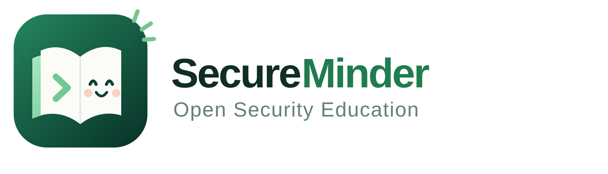

# SecureMinder

SecureMinder is a hands-on security education project. 

**[Visit SecureMinder](https://secureminder.com)**

## Start Learning

- **[Penetration Testing](https://secureminder.com/penetration-testing/):**
  Learn how to test approved networks, systems, applications and cloud
  services safely.
- **[Bug Bounty](https://secureminder.com/bug-bounty/):** Learn how to find and
  report security problems in websites and APIs.
- **[Kubernetes Security](https://secureminder.com/kubernetes-security/):**
  Learn where Kubernetes clusters can go wrong and how to secure them.
- **[AI Security](https://secureminder.com/ai-security/):** Learn how AI
  applications can be tricked and how to make them safer.

The full curriculum is available in the
[Open Security Education repository](https://github.com/secureminder/open-security-education).

## Meet the Curious Crew

They are learning too, and each one is curious about something different:

- **Aiko:** Asked the AI one question and came back with twelve more.
- **Buggie:** Notices the button everyone else ignores and has to find out what
  it does.
- **Scout:** Carries a magnifying glass, a notebook, and written permission.
- **Kubi:** Started with one YAML file and is still looking for the missing
  space.
